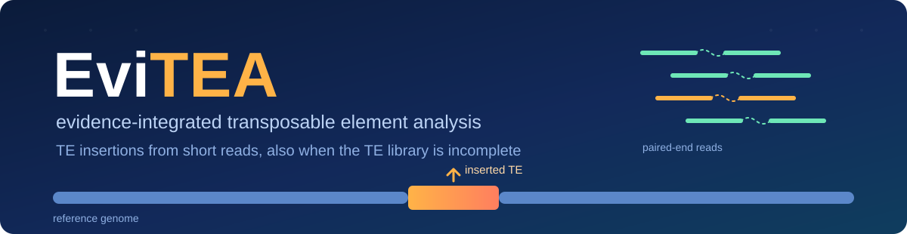
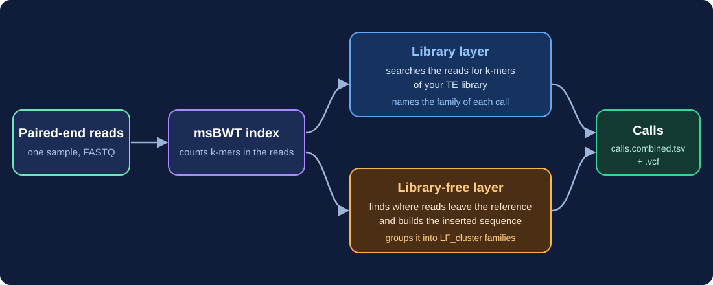

<p align="center">
  
</p>

<p align="center">
  <a href="https://github.com/Taksir/eviTEA/releases/tag/paper-2026-11-15"></a>
  
  <a href="LICENSE"></a>
  
</p>

<p align="center">
  <a href="#why-evitea">Why</a> &middot;
  <a href="#how-it-works">How it works</a> &middot;
  <a href="#install">Install</a> &middot;
  <a href="#quick-start">Quick start</a> &middot;
  <a href="#outputs">Outputs</a> &middot;
  <a href="#settings-used-in-the-paper">Paper settings</a> &middot;
  <a href="#citation">Citation</a>
</p>

EviTEA (evidence-integrated transposable element analysis) calls non-reference transposable element (TE) insertions from the paired-end short reads of one genome. For each insertion it reports the position and the TE family. It finds insertions of the families in your TE library, and it also finds insertions of families that the library does not contain.

The method is described in *EviTEA: calling transposable element insertions from short reads when the TE library is incomplete* (Majumder, manuscript in preparation). The code used for the paper is release [`paper-2026-11-15`](https://github.com/Taksir/eviTEA/releases/tag/paper-2026-11-15) (commit `d79d205`).

<a id="why-evitea"></a>

## 🧬 Why EviTEA

A TE library holds only the families that were known when someone built it. Library-based callers cannot name an insertion of any other family. In some genomes they are a large share of all insertions. The reads still hold the evidence for them. EviTEA uses that evidence, so one run gives one call set for both kinds of family.

<a id="how-it-works"></a>

## ⚙️ How it works

<p align="center">
  
</p>

EviTEA puts all reads of the sample into one index, a multi-string Burrows-Wheeler transform (msBWT; Holt and McMillan 2014). The index gives the exact count of any k-mer in the reads and the reads that contain it. EviTEA aligns with Bowtie2 only the reads it needs.

The library layer (`evitea call`) searches the index for k-mers of your TE library. It uses split reads and read pairs with one mate in unique genome sequence and the other mate in a TE. When the evidence shows a TE joined to the genome, the layer makes a call and names the family.

The library-free layer (`evitea library-free`) does not use the library. It finds sites where the reads stop following the reference, and it builds the inserted sequence from the reads on both sides. It then groups similar inserted sequences into families named `LF_cluster_<n>`. Such a family counts as a TE family when at least two independent insertions have junctions on both sides and a target-site duplication of 2 to 20 bp. Inserted sequence that the local reference, the mitochondrial genome, a segmental duplication or a tandem repeat explains is discarded. Library-free calls within 500 bp of a library call are left out, and the rest go into `calls.combined.tsv` with the library calls.

Every call needs support from independent read pairs, and each junction supports one call only. Evidence that EviTEA cannot resolve goes to `unresolved.tsv`.

<a id="install"></a>

## 📦 Install

You need CPython 3.14 (`>=3.14,<3.15`).

> [!NOTE]
> EviTEA is not on PyPI, so install it from a clone.

```bash
git clone https://github.com/Taksir/eviTEA.git
cd eviTEA
git checkout paper-2026-11-15          # the paper's code (skip this line for the newest code)
python -m pip install ".[anchorpe,library-free]"
evitea check-install
```

`pip` installs pymsbwt (0.5 or later, which builds the msBWT) and NumPy. The two extras are optional:

| Extra | Adds | Needed for |
|---|---|---|
| `anchorpe` | edlib | the paired-end step of `call`. On Windows, edlib has no CPython 3.14 wheel, so point `--edlib-python` at another interpreter that has it. |
| `library-free` | mappy, parasail | `library-free`, `build-family-records` and `--refine-breakpoints` (Linux or WSL only) |

Two programs must be on your `PATH`. pip does not install them:

- [Bowtie2](https://github.com/BenLangmead/bowtie2) 2.5.x, for every run.
- [BLAST+](https://blast.ncbi.nlm.nih.gov) (`makeblastdb`, `blastn`), only for runs without a TE library.

`evitea check-install` prints the version of every program and module that EviTEA uses. It exits with code 8 when a required one is missing.

<details>
<summary><b>Conda and container</b></summary>

With conda, `environment.yml` installs Python 3.14, Bowtie2 and BLAST+, and then installs EviTEA with both extras through pip:

```bash
conda env create -f environment.yml
conda activate evitea
evitea check-install
```

`containers/Containerfile` builds an image from the same file: `docker build -f containers/Containerfile -t evitea .` For Apptainer, run `apptainer build evitea.sif docker-daemon://evitea:latest` after that.

</details>

<a id="quick-start"></a>

## 🚀 Quick start

```bash
evitea run \
  --reference genome.fa --repeat-annotation repeat_annotation.bed \
  --te-library te_library.fa --family-map family_map.tsv \
  --read1 s_R1.fastq.gz --read2 s_R2.fastq.gz \
  --sample-id s --output runs/s --threads 8
```

Add `--library-free` to run the library-free layer too (Linux or WSL). If you have no TE library, give `--no-library` in place of `--te-library` and `--family-map` (see [Runs without a TE library](#runs-without-a-te-library)).

Each step writes to its own folder under `--output`. If a run stops, run the same command again and it continues from the last finished step. The final calls are in `runs/s/call/`, or in `runs/s/library_free/calls.combined.tsv` with `--library-free`.

> [!TIP]
> To try EviTEA first on a small data set, run `bash examples/synthetic/run_example.sh`. It makes a small genome, a library of 120 TE records and about 30x of 125 bp read pairs with 30 planted insertions. Then it runs `evitea run` and compares the calls with the expected ones. It takes about 10 minutes on 4 CPUs. The reads have no sequencing errors, so this checks that the programs work together, not how accurate they are. See [examples/README.md](examples/README.md).

<a id="inputs"></a>

## 📥 Inputs

| Input | What it is |
|---|---|
| Reference | FASTA of the reference genome |
| Repeat annotation | BED6 of the TE copies in the reference (contig, start, end, TE record, score, strand). See [docs/REPEAT_ANNOTATION.md](docs/REPEAT_ANNOTATION.md) for how to make it with RepeatMasker. |
| TE library | FASTA of TE consensus sequences. The first word of each header is the record name, and any names work. |
| Family map | the family of each TE record: two columns, `record<TAB>family`, or a FlyBase table with `FBte_ID` and `FlyBase_Family` columns |
| Reads | paired-end FASTQ in two files, plain or `.gz`. All reads must have the same length, so trim them first if they do not. |

EviTEA measures the read length and the 95th and 99th percentiles of the fragment size from the sample. It also finds the primary contigs and the mitochondrial contig of the reference. You can set each of these yourself with `--read-length`, `--fragment-q95`, `--fragment-q99` and `--primary-contigs`. [docs/CLI_AND_DATA.md](docs/CLI_AND_DATA.md) describes every input and option.

<a id="step-by-step"></a>

## 🪜 Step by step

<details>
<summary><b>The commands that <code>evitea run</code> calls</b></summary>

`evitea run` calls these commands in order. Run them yourself when you want to reuse the prepared reference and TE library for many samples:

```bash
evitea prepare-reference --reference genome.fa --repeat-annotation repeat_annotation.bed --output prepared/reference
evitea prepare-te --te-library te_library.fa --family-map family_map.tsv --build-languages \
  --reference-assets prepared/reference --output prepared/te
evitea prepare-sample --read1 s_R1.fastq.gz --read2 s_R2.fastq.gz --sample-id s --output prepared/s
evitea call --sample-assets prepared/s --reference-assets prepared/reference --te-assets prepared/te \
  --output runs/s/call
evitea library-free --run-dir runs/s/call --sample-assets prepared/s --reference-assets prepared/reference \
  --te-assets prepared/te --output runs/s/library_free
```

`prepare-reference` can adopt an existing Bowtie2 index of the same FASTA with `--bowtie2-index path/to/index/genome`.

`prepare-sample` keeps a map with one entry per read, and that map gets too large for full-size samples of tens of millions of reads. For those, build an msBWT of the reads yourself and give it to `call` and `library-free` with `--msbwt-index`. The mates of pair *i* must be records 2*i* and 2*i*+1 of the index.

```bash
evitea call --msbwt-index path/to/msbwt_index --sample-id s \
  --reference-assets prepared/reference --te-assets prepared/te --output runs/s/call
```

Run `evitea <command> --help` for all options.

</details>

<a id="outputs"></a>

## 📤 Outputs

| File | Content |
|---|---|
| `calls.tsv` | one line per call in genomic order, with the supporting read pair IDs |
| `calls.bed`, `calls.vcf` | the same calls as BED and as VCF 4.2 (symbolic `<INS:ME:family>` alleles, sites only) |
| `calls.native.tsv` | all library calls in a 15-column table, before the own-family copy filter. `library-free` and `call-tiers` read it. |
| `resident_copy_dropped.tsv` | the calls that the own-family copy filter removed, each with the reference copy that caused it |
| `unresolved.tsv` | evidence that EviTEA does not report as a call |
| `run_summary.json` | call counts per step |
| `run.log`, `run_manifest.json` | the log, and hashes of every output with the values measured from the sample |

`library-free` adds `calls.library_free.tsv`, `calls.combined.tsv` and `calls.combined.vcf`. EviTEA never overwrites a finished output folder.

The own-family copy filter removes a library call that touches or overlaps a reference copy of its own family. The reference already has that family at that spot. The copies come from your repeat annotation. The filter changes the final tables only. `calls.native.tsv` stays complete, and library-free calls are never filtered. Give `--keep-resident-copies` to turn the filter off. When you run `library-free` on a run with library calls, give either `--te-assets` or `--keep-resident-copies`.

<a id="runs-without-a-te-library"></a>

## 🧪 Runs without a TE library

`evitea run --no-library` needs only the reference and the reads:

1. `build-repeat-map` maps repeats in the reference with BLAST+.
2. The library-free layer calls insertions and groups them into families.
3. `build-family-records` turns those families into TE records.
4. The library layer runs again on those records, and `add-record-calls` adds its calls.

The final calls are in `record_pass/added/calls.combined.tsv`. The same chain is in `tools/no_library.sh` (plain shell) and `tools/slurm/no_library.sh` (Slurm). See [docs/REPEAT_ANNOTATION.md](docs/REPEAT_ANNOTATION.md).

> [!IMPORTANT]
> The no-library results in the paper come from the library-free layer alone, not from this full chain. The command is under [Settings used in the paper](#settings-used-in-the-paper).

<a id="settings-used-in-the-paper"></a>

## 📄 Settings used in the paper

The results of the paper come from commit `d79d205` (release `paper-2026-11-15`). The run times at 10x to 30x and the recall by allele fraction (Table S7C) come from the earlier commit `296e725` of the same history. The read index of each sample was built with the msBWT software (msbwt-modern3 0.3.0, [github.com/Taksir/msbwt](https://github.com/Taksir/msbwt) commit `19eea78`).

The runs set some options that are off or different by default:

```bash
# library mode: three steps per sample
evitea call --msbwt-index <index> --sample-id <sample> --reference-assets <ref> --te-assets <te> \
    --threads <n> --mate-side-rule strand
evitea refine-breakpoints --run-dir <run> --msbwt-index <index> --reference-assets <ref> --te-assets <te> \
    --pin-one-sided --call-annotations
evitea library-free --run-dir <run> --msbwt-index <index> --reference-assets <ref> --te-assets <te> \
    --contigs <contigs> --workers <n> --weak-site-pass --weak-site-allele-depth-cut 10 --extension-stop-min 2

# no-library mode: the library-free layer alone, with no TE library and no annotation
evitea library-free --run-dir <empty run> --msbwt-index <index> --reference-assets <ref> \
    --contigs <contigs> --workers <n> --extension-stop-min 2 --resident-guard off
```

`<empty run>` is a folder with an empty library call set, like the `nolib_stub/` folder that `evitea run --no-library` writes. Some library-mode runs raised the work limit of the wide-anchor step with `--max-rescue-interval-mass` (default 1,500,000): 2,000,000 for JUT-011 and ISO1, and 100,000,000 for the mouse. Table S1 of the paper lists the full commands, contigs, thread counts and software versions of every run.

<a id="limits"></a>

## ⚠️ Limits

- Reads must be paired-end and all of one length.
- Only CPython 3.14 is supported. The library-free layer and the family-record commands run on Linux or WSL only.
- `prepare-sample` does not scale to full-size samples. Use `--msbwt-index` for those.
- The paper measured accuracy on the species and strains above. Accuracy on other species, and on read lengths other than those tested, is not known.

<a id="tests"></a>

## ✅ Tests

Install pytest and run `python -m pytest`. The suite includes an end-to-end test on synthetic data (`tests/integration/test_synthetic_call.py`). It must find every planted insertion with its family, with both FlyBase and plain TE names and with fly and non-fly contig names. `tools/synthetic/compare_call.sh` compares the library layer of two versions on a synthetic sample, byte for byte.

The scripts under `validation/` compare this code with the research code it came from. They need data that is not distributed. See [validation/README.md](validation/README.md). The profiles `AKA017` and `ISO1` of `--profile` exist only for those checks. The default, `production`, is the one to use.

<a id="citation"></a>

## 📚 Citation

If you use EviTEA, please cite the paper:

> Majumder MTH. EviTEA: calling transposable element insertions from short reads when the TE library is incomplete. Manuscript in preparation.

For the software itself, see [CITATION.cff](CITATION.cff).

<a id="license"></a>

## ⚖️ License

Copyright (C) 2026 Md Taksir Hasan Majumder. EviTEA is free software under the GNU General Public License, version 3 or later ([LICENSE](LICENSE)). If you distribute a modified version, it must also be under the GPL, with its source and the original copyright notice.

EviTEA uses msBWT (James Holt and Leonard McMillan), Bowtie2, BLAST+, mappy (minimap2), parasail, edlib and NumPy. [THIRD_PARTY_NOTICES](THIRD_PARTY_NOTICES) lists their licenses.
